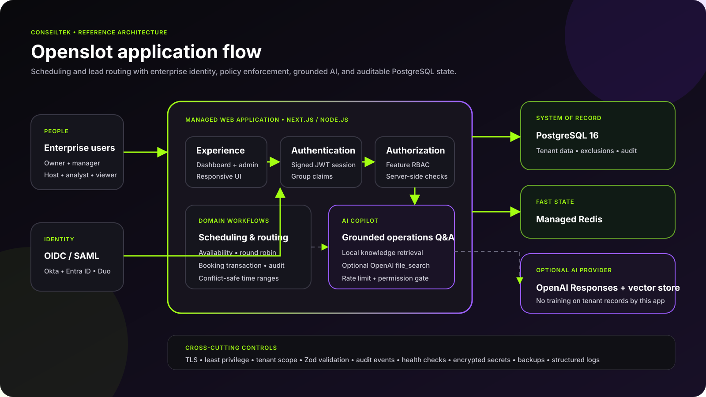
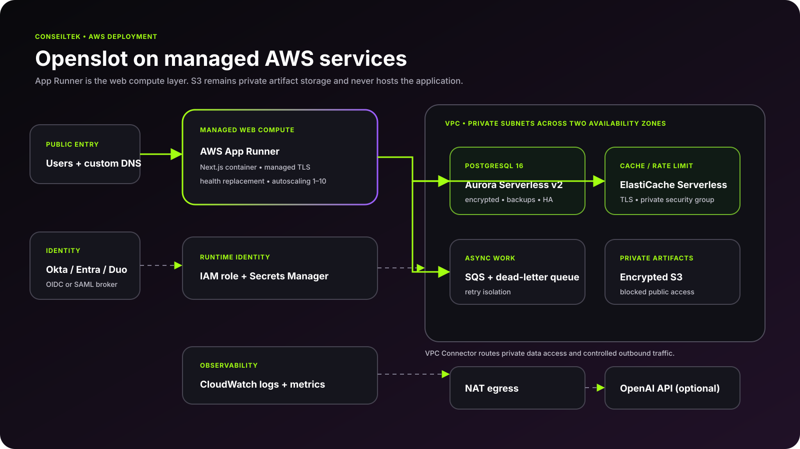
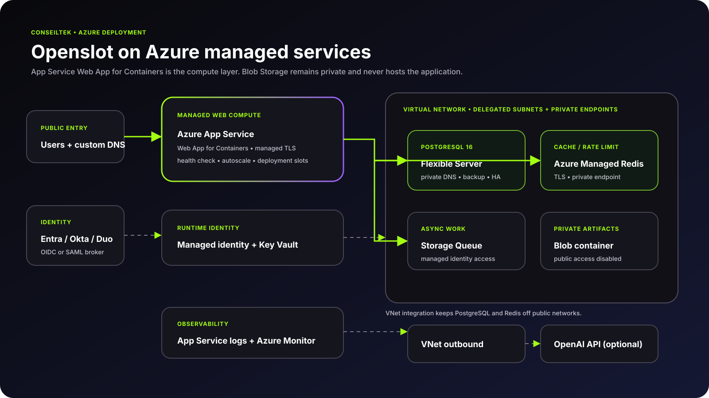

<div align="center">
  
  <h1>Openslot</h1>
  <p><strong>Self-hosted scheduling and lead routing for teams that need control.</strong></p>
  <p>Enterprise SSO · feature-level RBAC · PostgreSQL · grounded AI · AWS and Azure infrastructure as code</p>
</div>

[](https://github.com/ConseilTek-Tektons/openslot/actions/workflows/ci.yml)
[](https://github.com/ConseilTek-Tektons/openslot/actions/workflows/codeql.yml)
[](LICENSE)

Openslot is a deployable ConseilTek reference application for managing event types, availability, round-robin pools, lead routing, bookings, and scheduling operations. The repository includes a polished dashboard, transactional API routes, a PostgreSQL schema that prevents double-booking, local enterprise identity, tests, container packaging, and validated infrastructure definitions.



## What is included

- Working Next.js 15 application with responsive ConseilTek visual design
- Booking dashboard, route-pool visibility, utilization analytics, copyable booking links, and create-booking interaction
- Conflict-safe PostgreSQL 16 model using an exclusion constraint on host time ranges
- Feature-level RBAC enforced in both navigation and server-side API routes
- Generic OIDC login for Okta and Microsoft Entra ID; SAML providers such as Duo can connect through Keycloak or another broker
- AI routing copilot with local grounded retrieval and optional OpenAI Responses API `file_search`
- Redis-backed distributed assistant rate limiting with a safe local fallback
- Audit events, health/readiness checks, validation, database migrations, and realistic seed data
- Local Docker Compose stack with PostgreSQL, Redis, and a preconfigured Keycloak realm
- AWS App Runner + Aurora PostgreSQL Serverless v2 + ElastiCache Serverless Terraform
- Azure App Service Web App for Containers + PostgreSQL Flexible Server + Azure Managed Redis Bicep

## Run the complete local stack

Requirements: Docker with Compose v2, or Node.js 22+ and pnpm 11 for manual development.

```bash
cp .env.example .env
docker compose up --build
```

Open [http://localhost:3000](http://localhost:3000). The local Keycloak realm is available at [http://localhost:8080](http://localhost:8080). The realm import and demo credentials are documented in [Authentication](docs/AUTHENTICATION.md).

For a fast UI-only tour, keep `AUTH_DEMO_MODE=true` and use one of the visible demo personas. Demo mode is forcibly off in production unless it is deliberately re-enabled.

## Manual development

```bash
pnpm install
pnpm db:migrate
pnpm db:seed
pnpm dev
```

The service checks configuration at runtime. PostgreSQL is the system of record; Redis improves distributed rate limiting but does not hold durable business records.

## Cloud deployment

This repository intentionally does **not** recommend static-web hosting. Openslot has authenticated server routes, database transactions, SSO callbacks, and AI orchestration. It belongs on a managed application runtime:

| Cloud | Web compute | PostgreSQL | Cache | Infrastructure |
|---|---|---|---|---|
| AWS | AWS App Runner | Aurora PostgreSQL Serverless v2 | ElastiCache Serverless | [Terraform guide](infra/aws/README.md) |
| Azure | Azure App Service Web App for Containers | PostgreSQL Flexible Server | Azure Managed Redis | [Bicep guide](infra/azure/README.md) |

These managed services reduce operational maintenance by handling web-runtime availability, TLS integration, scaling, database backups, patching, and cache operations. Private S3/Blob storage is used only for application artifacts—not to host the web app.





## Enterprise controls

- [Architecture and request flow](docs/ARCHITECTURE.md)
- [Authentication: Okta, Entra ID, Duo, OIDC, and SAML](docs/AUTHENTICATION.md)
- [Role-based access control](docs/RBAC.md)
- [AI and RAG configuration](docs/AI.md)
- [Security model](docs/SECURITY.md)
- [Operations and release readiness](docs/OPERATIONS.md)

## Quality gates

```bash
pnpm check
terraform -chdir=infra/aws validate
bicep build infra/azure/main.bicep
docker build -t openslot:local .
```

CI repeats linting, static type analysis, tests, the production build, container build, Terraform validation, and Bicep compilation.

## Repository map

```text
src/app/                 pages and authenticated API routes
src/components/          application shell, dashboards, AI, access UI
src/config/              product and RBAC policy configuration
src/lib/                 authorization, database, retrieval, rate limits
db/migrations/           versioned PostgreSQL schema
knowledge/               approved documents for optional RAG ingestion
deploy/keycloak/         local identity-broker realm
infra/aws/               App Runner architecture in Terraform
infra/azure/             App Service architecture in Bicep
docs/architecture/       editable SVG architecture diagrams
```

## License

Apache 2.0. See [LICENSE](LICENSE). The ConseilTek trademarks and supplied brand artwork remain the property of ConseilTek; the source code is licensed independently.
